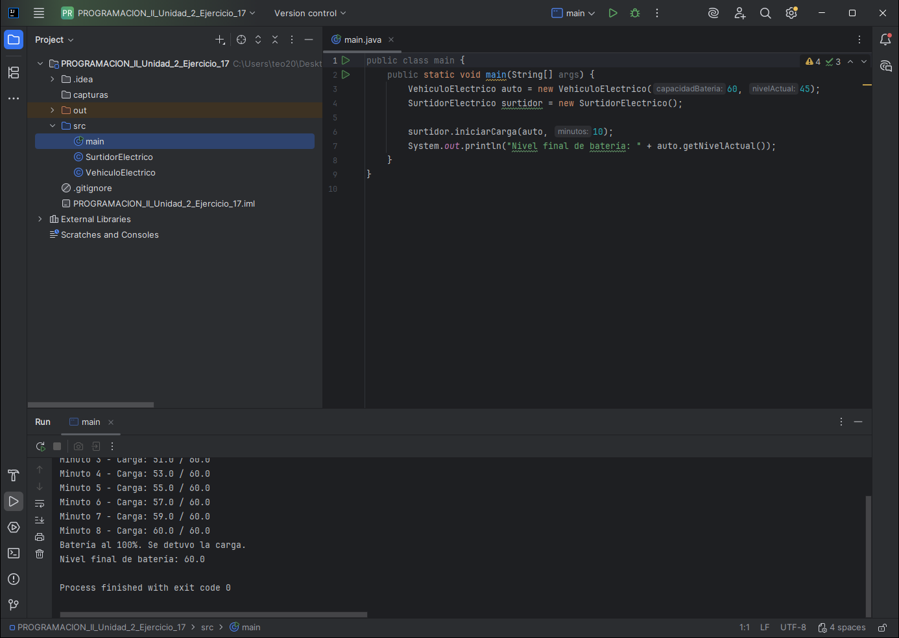

# PROGRAMACIÓN II — Unidad 2, Ejercicio 17: La Estación de Carga para Vehículos Eléctricos

Trabajo práctico de Programación II. Este repositorio contiene la resolución en Java del ejercicio 17 de la Unidad 2.

## Consigna

#### Contexto

En una electrolinera inteligente, cuando un automóvil eléctrico se conecta al surtidor, se inicia una comunicación constante mediante mensajes de telemetría donde el vehículo le informa su nivel de batería actual al cargador para regular la potencia.

#### Consigna

Simular el intercambio de mensajes cíclicos o puntuales entre un objeto VehiculoElectrico y un objeto SurtidorElectrico durante el proceso de carga de energía.

#### Desarrollo requerido

- Crear la clase VehiculoElectrico con atributos como capacidadBateria y nivelActual, y un método recibirCarga(double kw) que incremente su energía.
- Diseñar la clase SurtidorElectrico que contenga un método iniciarCarga(VehiculoElectrico vehiculo, int minutos) que simule el suministro energético enviando mensajes al vehículo.
- Agregar validaciones para que la carga se detenga automáticamente si el nivel actual alcanza el 100%.
- En el método main, instanciar un vehículo con baja carga, conectarlo al surtidor, ejecutar la rutina de transferencia de energía y mostrar el progreso por consola.

## Estructura del repositorio

```
PROGRAMACION_II_Unidad_2_Ejercicio_17/
├── README.md
├── capturas/
│   └── consola.png
└── src/
    ├── main.java   # clase con el método main
    ├── SurtidorElectrico.java
    └── VehiculoElectrico.java
```

## Funcionamiento y lógica

El ejercicio simula la carga de un auto eléctrico: el surtidor le envía energía al vehículo minuto a minuto hasta que la batería se llena o se termina el tiempo.

### `VehiculoElectrico`

Tiene `capacidadBateria` y `nivelActual`. Su método `recibirCarga(double kw)` suma la energía recibida sin superar nunca la capacidad máxima.

### `SurtidorElectrico`

Su método `iniciarCarga(vehiculo, minutos)` repite un ciclo una vez por minuto:

1. Si la batería ya está llena, avisa que llegó al 100 % y corta la carga con `break`.
2. Si no, le envía **2 kW** al vehículo y muestra con `printf` cómo va la carga.

### `main`

Crea un auto con batería de 60 kW y 45 kW cargados, y lo conecta 10 minutos. La carga sube de a 2 kW por minuto. En el minuto 8 llega a 60 kW (el último aporte se recorta para no pasar el máximo), y en el minuto siguiente el surtidor detecta la batería llena y se detiene. El nivel final es **60.0**.

## Ejecución

Captura de la consola de IntelliJ IDEA ejecutando el programa:



Salida obtenida:

```
Minuto 1 - Carga: 47.0 / 60.0
Minuto 2 - Carga: 49.0 / 60.0
Minuto 3 - Carga: 51.0 / 60.0
Minuto 4 - Carga: 53.0 / 60.0
Minuto 5 - Carga: 55.0 / 60.0
Minuto 6 - Carga: 57.0 / 60.0
Minuto 7 - Carga: 59.0 / 60.0
Minuto 8 - Carga: 60.0 / 60.0
Batería al 100%. Se detuvo la carga.
Nivel final de batería: 60.0
```
